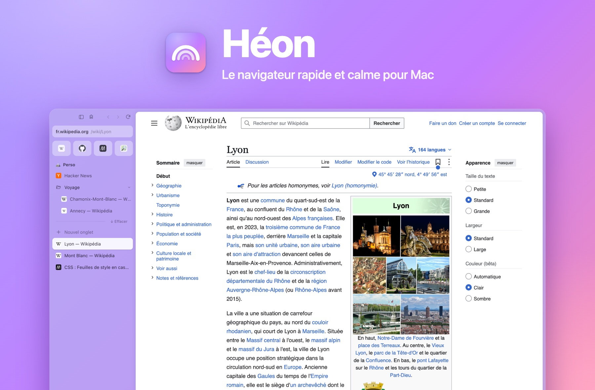
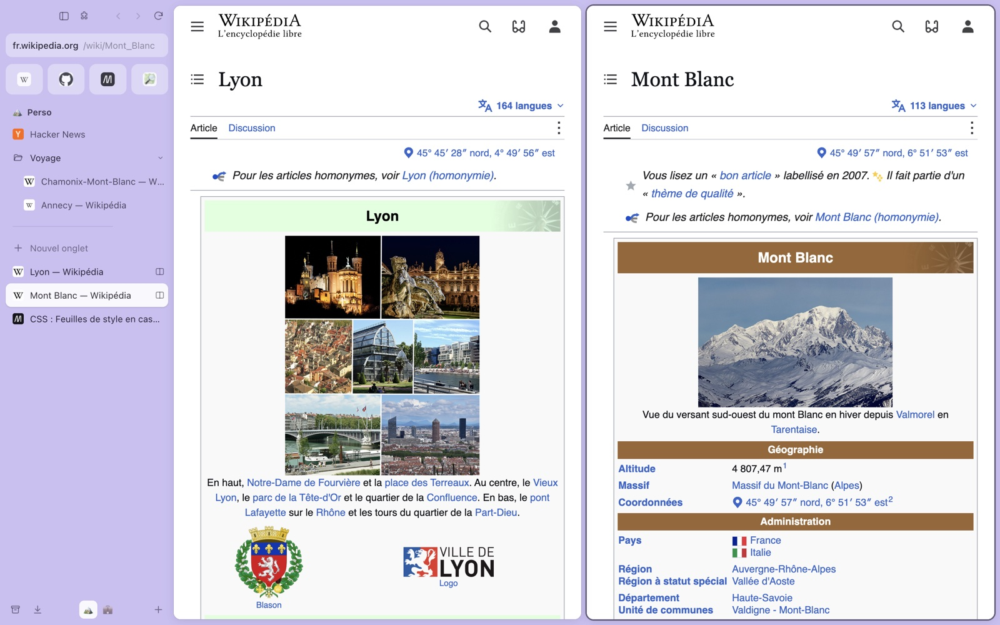

 

**Onglets verticaux, espaces, pages qui s’ouvrent avant même que tu cliques.** 
Gratuit. Sans pub. Sans compte. Sans pistage.

 

 

Mac avec puce Apple · mises à jour automatiques et signées · <a href="#-in-english">English below</a>

---

## ✨ Pourquoi Héon

<table>
<tr>
<td width="50%" valign="top">

### ⚡ Instantané
Héon prépare la page pendant que tu tapes ou que tu survoles un lien : quand tu appuies sur Entrée, elle est **déjà là**. Les onglets endormis se réveillent en un clin d’œil.

</td>
<td width="50%" valign="top">

### 🧘 Calme
Onglets **verticaux**, rangés en **espaces** (Perso, Travail…) et en dossiers. Les onglets du jour s’archivent seuls après 12 h : plus jamais 80 onglets ouverts.

</td>
</tr>
<tr>
<td valign="top">

### 🛡️ Privé
**Bloqueur de pubs et de traqueurs** intégré, HTTPS partout, DNS chiffré, liens nettoyés. Pas de compte, pas de statistiques : rien n’est envoyé au développeur.

</td>
<td valign="top">

### ⌨️ Tout au clavier
**⌘T** pour tout trouver (onglets, historique, actions), **Ctrl+Tab** pour passer d’un onglet à l’autre avec aperçus, **⌘ clic** pour ouvrir en arrière-plan.

</td>
</tr>
</table>

> **Tu viens d’Arc ?** Au premier lancement, Héon importe tes espaces, tes onglets épinglés et tes favoris. Chrome, Brave, Edge et Safari aussi.

## 📸 En images

**La barre de commande** : un onglet, une page de l’historique, une recherche, une action : tout part de ⌘T.

  

**Ctrl+Tab** : tes onglets récents avec un aperçu, comme ⌘Tab sur macOS.

  

**Split view** : deux pages côte à côte (⌃⇧=).

  

**Mode lecture** (⌥⌘R) : juste le texte et les images, en clair, sépia ou nuit.

## 📦 Installer

1. **[Télécharger Héon](https://github.com/Andre27aj/heon-versions/releases/latest/download/Heon-arm64.dmg)** (Mac avec puce Apple : M1, M2, M3, M4…).
2. Ouvrir le `.dmg` et glisser **Héon** dans **Applications**.
3. **Premier lancement** : Héon n’est pas encore notarié par Apple, macOS demande donc une confirmation la première fois.
   - Ouvrir Héon (macOS affiche un avertissement), puis **Réglages Système → Confidentialité et sécurité**, tout en bas : **« Ouvrir quand même »**.
   - Ou, dans le Terminal : `xattr -dr com.apple.quarantine /Applications/Heon.app`

C’est tout : ensuite, Héon se met à jour **tout seul**. Quand une version sort, une notification te propose de redémarrer, et tu retrouves tes onglets.

## 🧰 Tout ce qu’il sait faire

<b>Onglets et organisation</b>

- **Espaces** avec leur couleur, leurs onglets épinglés et leurs dossiers ; **favoris** partagés en haut de la barre latérale.
- **Onglets du jour** archivés automatiquement après 12 h d’inactivité (retrouvables dans l’archive, ⌘Y).
- **Ctrl+Tab** : sélecteur avec aperçus, du plus récent au plus ancien.
- **⌘ clic** ou clic molette : nouvel onglet en arrière-plan, même sur les sites qui gèrent leurs liens en JavaScript. Ses vidéos attendent que tu ailles sur l’onglet.
- **Peek** (⇧ clic sur un lien) : la page s’ouvre par-dessus, sans créer d’onglet.
- **Split view**, plusieurs fenêtres, sélection de plusieurs onglets à la fois (fermer, épingler, déplacer…).
- **Little Héon** : un lien cliqué dans une autre app s’ouvre dans une petite fenêtre ; règles « tel site → tel espace ».

<b>Vitesse</b>

- Pré-rendu de la page choisie dans la barre de commande : Entrée l’affiche instantanément.
- Complétion de l’adresse pendant la frappe, comme dans Chrome.
- Connexion ouverte dès le survol d’un lien, et vers tes sites les plus visités au démarrage.
- Les onglets endormis commencent à charger quand tu les survoles, sans bruit ni indicateur.

<b>Lecture et vidéo</b>

- **Mode lecture** (⌥⌘R) : taille du texte, police, thèmes clair / sépia / gris / nuit, temps de lecture.
- **Vitesse des vidéos** sur chaque vidéo (touches S / D / R), **image dans l’image automatique** quand tu changes d’onglet.
- **YouTube** sans miniatures ni Shorts (optionnel), **traduction** de page (⌥⌘T), lecteur **PDF**, **impression**.
- **Boosts** : ton propre CSS / JS pour n’importe quel site.

<b>Mots de passe</b>

- Enregistrement et remplissage automatiques, chiffrés dans le trousseau macOS ; **Touch ID** pour les afficher.
- **Mots de passe forts** proposés à l’inscription, enregistrés tout seuls.
- Import / export avec l’app **Mots de passe** d’Apple (donc ton iPhone) et en CSV depuis les autres navigateurs.

<b>Vie privée et sécurité</b>

- **Bloqueur de publicités et de traqueurs**, désactivable site par site (clic droit sur la page).
- HTTPS uniquement, DNS chiffré, paramètres de pistage retirés des liens, protection contre l’hameçonnage et les sites malveillants.
- **Fenêtre privée** (⇧⌘N), **espace privé** (⇧⌘P), **profil séparé** par espace (comptes et cookies à part).
- Chaque page tourne isolée (bac à sable Chromium) ; caméra, micro, position… sont demandés site par site.
- Moteur **Chromium** suivi de près : Héon prévient dès qu’un correctif de sécurité sort.
- Tout se règle dans **Addons et sécurité** (⇧⌘A).

<b>Raccourcis clavier</b>

| Raccourci | Action |
| --- | --- |
| ⌘T | Barre de commande / nouvel onglet |
| ⌘L | Modifier l’adresse |
| Ctrl+Tab | Sélecteur d’onglets avec aperçus |
| ⌘ clic · ⇧⌘ clic | Ouvrir le lien en arrière-plan · et y aller |
| ⇧ clic | Ouvrir le lien dans Peek |
| ⌘N / ⇧⌘N | Nouvelle fenêtre / fenêtre privée |
| ⌘W / ⇧⌘T | Fermer / rouvrir un onglet |
| ⌘D | Épingler / désépingler |
| ⌘S | Afficher / masquer la barre latérale |
| ⌃⇧= | Split view |
| ⌥⌘R | Mode lecture |
| ⌥⌘T | Traduire la page |
| ⌥⌘P | Mots de passe |
| ⌥⌘L | Téléchargements |
| ⇧⌘A | Addons et sécurité |
| ⌘F, ⌘±, ⌘0 | Recherche, zoom |

## ❓ Questions

<b>C’est vraiment gratuit ?</b>

Oui. Pas d’abonnement, pas de pub, pas de compte, pas de données revendues : Héon n’envoie rien au développeur.

<b>Pourquoi macOS affiche un avertissement au premier lancement ?</b>

Héon n’est pas encore notarié par Apple. Chaque mise à jour est en revanche **signée** : Héon vérifie la signature avant de l’installer et refuse toute version qui ne vient pas du développeur.

<b>Et sur un Mac Intel ? Sur Windows ?</b>

Pas pour l’instant : Héon est fait pour les Mac avec puce Apple.

<b>Ce qui ne marche pas encore</b>

- Netflix, Disney+ et autres vidéos protégées.
- Clés d’accès (passkeys) : utiliser le mot de passe (« Essayer une autre méthode »).
- Extensions Chrome : une partie seulement fonctionne (bouton « Ajouter à Héon » sur le Chrome Web Store).

<b>Désinstaller</b>

Mettre **Héon** (dans Applications) à la corbeille. Les données restent dans `~/Library/Application Support/Arco` : supprimer ce dossier pour tout effacer.

---

## 🇬🇧 In English

**Héon** is a free, fast and calm web browser for Apple Silicon Macs, inspired by Arc: vertical tabs, spaces and folders, a ⌘T command bar, a Ctrl+Tab switcher with previews, split view, reader mode, a built-in ad & tracker blocker, and pages that are pre-loaded before you even click. No account, no telemetry. Imports your Arc spaces, and data from Chrome, Brave, Edge or Safari. The interface is in French.

**[Download for Mac](https://github.com/Andre27aj/heon-versions/releases/latest/download/Heon-arm64.dmg)**, drag Héon into Applications, then on first launch allow it in *System Settings → Privacy & Security → Open Anyway* (the app is not notarized yet). Updates are automatic and signed.

 

 
Ce dépôt contient les installeurs de Héon et ce mode d’emploi.

