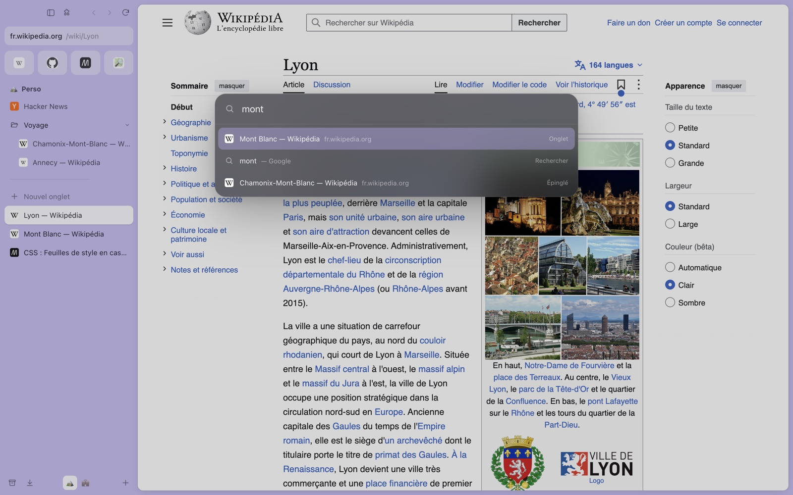
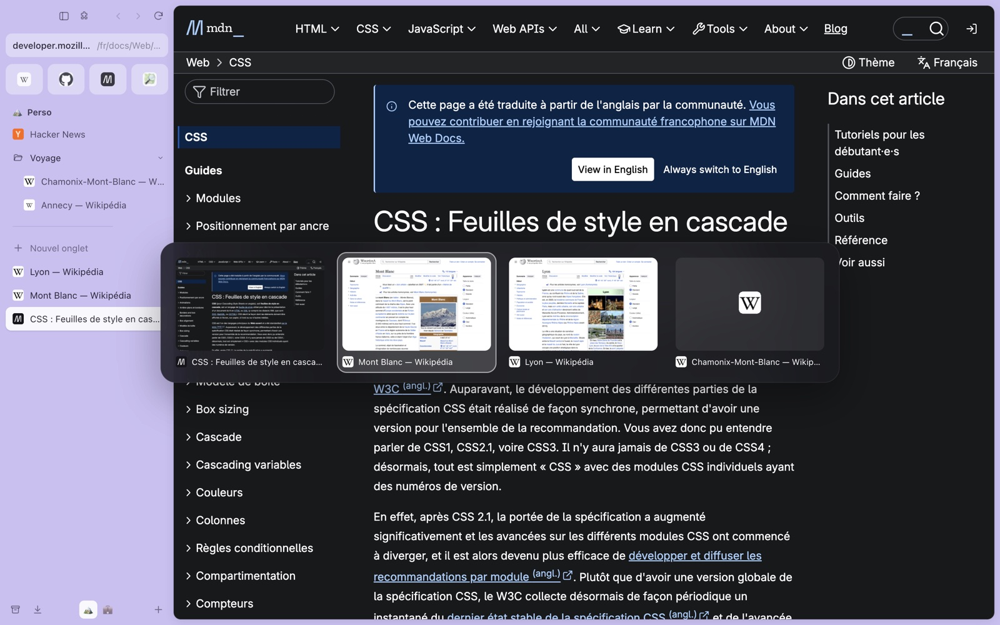
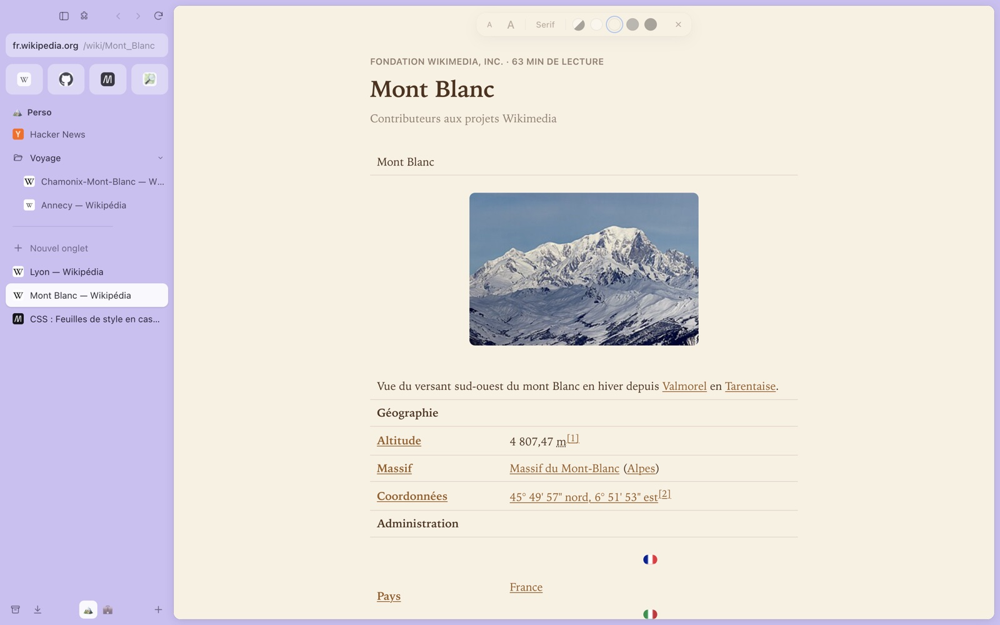
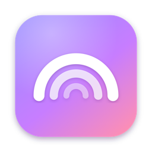

 

**Onglets verticaux, espaces, barre de commande. Natif macOS, 6 Mo.** 
Gratuit. Sans pub. Sans compte. Sans pistage.

 

 

Mac avec puce Apple · macOS 14 ou plus récent · mises à jour automatiques et signées · <a href="#-in-english">English below</a>

---

## ✨ Pourquoi Héon

<table>
<tr>
<td width="50%" valign="top">

### ⚡ Natif et léger
Écrit en **Swift**, avec le moteur de Safari (WebKit) : **6 Mo** au lieu de 250, démarrage instantané, moins de mémoire, plus d’autonomie sur portable. Les onglets endormis se réveillent en un clin d’œil.

</td>
<td width="50%" valign="top">

### 🧘 Calme
Onglets **verticaux**, rangés en **espaces** (Perso, Travail…) et en dossiers. Les onglets du jour s’archivent seuls après 12 h : plus jamais 80 onglets ouverts.

</td>
</tr>
<tr>
<td valign="top">

### 🛡️ Privé
**Bloqueur de pubs, de traqueurs et de bandeaux de cookies** intégré au moteur, HTTPS partout, liens nettoyés. Pas de compte, pas de statistiques : rien n’est envoyé au développeur.

</td>
<td valign="top">

### ⌨️ Tout au clavier
**⌘T** pour tout trouver (onglets, historique, actions), **Ctrl+Tab** pour passer d’un onglet à l’autre avec aperçus, **⌘ clic** pour ouvrir en arrière-plan.

</td>
</tr>
</table>

> **Tu viens d’Arc ?** Au premier lancement, Héon importe tes espaces, tes onglets épinglés et tes favoris. Chrome, Brave, Edge et Safari aussi.

## 📸 En images

**La barre de commande** : un onglet, une page de l’historique, une recherche, une action : tout part de ⌘T.

  

**Ctrl+Tab** : tes onglets récents avec un aperçu, comme ⌘Tab sur macOS.

  

**Split view** : deux pages côte à côte (⌃⇧=, ou glisser un onglet sur un autre), séparation réglable à la souris.

  

**Mode lecture** (⌥⌘R) : juste le texte et les images, en clair, sépia ou nuit.

## 📦 Installer

1. **[Télécharger Héon](https://github.com/Andre27aj/heon-versions/releases/latest/download/Heon-arm64.dmg)** (Mac avec puce Apple : M1, M2, M3, M4…).
2. Ouvrir le `.dmg` et glisser **Héon** dans **Applications**.
3. **Premier lancement** : Héon n’est pas encore notarié par Apple, macOS demande donc une confirmation la première fois.
   - Ouvrir Héon (macOS affiche un avertissement), puis **Réglages Système → Confidentialité et sécurité**, tout en bas : **« Ouvrir quand même »**.
   - Ou, dans le Terminal : `xattr -dr com.apple.quarantine /Applications/Heon.app`

C’est tout : ensuite, Héon se met à jour **tout seul**. Quand une version sort, une notification te propose de redémarrer, et tu retrouves tes onglets.

## 🧰 Tout ce qu’il sait faire

<b>🆕 Nouveau (1.0.9 → 1.0.25)</b>

- **Masquer un élément pour de bon** (⇧⌘H) : clique sur un pop-up, une bannière ou une barre inutile, il disparaît sur ce site, aussi aux prochaines visites.
- **Rechercher dans tous les onglets** (⌥⌘F, ou ⌘T puis « / ») : un mot, et la liste des onglets qui le contiennent, avec un extrait.
- **Lecteur PDF** : miniatures, recherche, surlignage, soulignement, notes ; tes annotations sont gardées.
- **Rapports de plantage** : quand une page plante, copie le rapport ou signale-le sur GitHub (rien n’est envoyé sans toi).
- **⌃Tab plus rapide et plus sobre** : seulement les onglets ouverts depuis le lancement ; celui où tu t’arrêtes est préparé d’avance, et tes 3 derniers restent prêts. Au lancement, plus aucune page ne se charge toute seule. Passage d’un onglet à l’autre en fondu, avec le dernier aperçu pendant le réveil (1.0.20).
- **Plein écran vidéo dans son propre bureau** : la fenêtre de Héon se masque pendant le plein écran, ⌘Tab ramène sur la vidéo (1.0.20).
- **⌫ ne fait plus quitter les jeux** (Tusmo, Wordle…) : hors d’un champ de texte, la touche ne revient plus à la page précédente, comme dans Safari (1.0.21).
- **« Effacer les données du site » plus radical** : chaque cookie du site est supprimé, même un vieux jeton en double qui bloquait le site, y compris ceux repris de l’ancienne version (1.0.22–1.0.23).
- **Groupes d’onglets** : sélectionne plusieurs onglets (⌘ clic / ⇧ clic) → barre d’actions, glisser d’un coup, et **« Mettre de côté »** : le groupe quitte la sidebar et se rouvre d’un clic depuis « Mis de côté » (synchronisé entre tes Mac) (1.0.24).
- **Lecteur PDF amélioré** : rotation des pages, compteur de pages, ajuster à la largeur ; ⌘S et « Télécharger » donnent le vrai fichier PDF avec tes annotations (1.0.25).
- **⌘T plus clair** : moins de suggestions, les sites visités récemment en premier, et « Demander à l’IA » juste sous le premier choix (**⌘↩** pour y aller directement). Les menus sont rangés comme dans Safari et Chrome.
- **IA sur ton Mac par défaut** : gratuite, sans compte, rien ne sort du Mac (Ollama ou LM Studio). Au choix aussi : ton compte **OpenRouter** (Claude, Gemini, GPT, sans clé à coller). Idées reprises de [Search](https://github.com/driceroland/Search) (MIT).
- **IA avec ton abonnement ChatGPT** : dans Réglages › IA, choisis « Codex » — Héon passe par Codex, l’outil officiel d’OpenAI, et consomme ton abonnement au lieu d’une clé API.
- **Split view plus simple** : glisse un onglet sur un autre dans la barre latérale pour les ouvrir côte à côte, et règle la largeur en tirant la séparation (curseur ⟺).
- **Réglages redessinés** dans le style de Héon : navigation à gauche, couleurs de l’espace, interrupteurs.
- **YouTube** : **SponsorBlock** intégré (les passages sponsorisés sont sautés, bouton « Revoir »), **Return YouTube Dislike** (le nombre de « je n’aime pas » revient) et **DeArrow** (titres et miniatures sans putaclic). Rien à installer.
- **Correcteur LanguageTool** dans les champs de texte : une pastille indique les fautes, un clic propose les corrections (texte envoyé à languagetool.org, jamais en navigation privée ni dans les mots de passe ; désactivable).
- **Adresses et cartes bancaires** remplies automatiquement dans les formulaires (livraison, paiement). Le numéro de carte est chiffré sur ton Mac, **Touch ID** est demandé à chaque fois, seulement sur les sites en HTTPS ; le cryptogramme n’est jamais enregistré.
- **Liste de lecture** (⇧⌘D) avec une **copie lisible hors ligne** ; retrouvée dans la Bibliothèque (⌥⌘Y).
- **Enregistrer la page** (⇧⌘S) en PDF (pages ou une seule longue page), image PNG, archive web, HTML ou texte.
- **Ouvrir un fichier** du Mac (⇧⌘O) : PDF, HTML, images, vidéos…
- **Vidéos .mov sur Google Drive** lues directement (iPhone, HEVC, ProRes), même quand Drive affiche « traitement en cours ».
- **⇧⌘T** rouvre aussi les onglets fermés avant un redémarrage, les onglets épinglés et les onglets archivés.
- **Ouvrir la page dans** Safari, Chrome… ; **QR code** de la page pour l’iPhone ; **note** par site ; **toujours couper le son** d’un site ; **⌃M** coupe le son de l’onglet.
- Recherche : **⌘G / ⇧⌘G** résultat suivant / précédent, **⌘E** chercher la sélection ; **⌘T « @ »** ne cherche que dans les onglets ouverts.
- **⌥⌘U** code source, **⌘.** arrêter le chargement, **⇧⌘] / ⇧⌘[** onglet suivant / précédent, **dupliquer l’onglet**, correcteur d’**orthographe** et lecture **à voix haute**.

<b>Onglets et organisation</b>

- **Espaces** avec leur couleur, leurs onglets épinglés et leurs dossiers ; **favoris** partagés en haut de la barre latérale.
- **Onglets du jour** archivés automatiquement après 12 h d’inactivité (retrouvables dans l’archive, ⌘Y).
- **Ctrl+Tab** : sélecteur avec aperçus, du plus récent au plus ancien.
- **⌘ clic** ou clic molette : nouvel onglet en arrière-plan, même sur les sites qui gèrent leurs liens en JavaScript. Ses vidéos attendent que tu ailles sur l’onglet.
- **Peek** (⇧ clic sur un lien) : la page s’ouvre par-dessus, sans créer d’onglet.
- **Split view**, plusieurs fenêtres, **groupes d’onglets**, onglets **renommés** (double-clic) et titres rendus propres automatiquement.
- **Little Héon** : un lien cliqué dans une autre app s’ouvre dans une petite fenêtre ; règles « tel site → tel espace ».

<b>Nouveau dans la version native (1.0)</b>

- **Centre de contrôle du site** (à gauche de l’adresse) : bloqueur, mode sombre, zoom, Boost, permissions, capture, partage.
- **Dossiers vivants** : tes pull requests GitHub, un flux RSS ou une chaîne YouTube qui se remplissent tout seuls.
- **Agenda en direct** : ta prochaine réunion en bas de la barre latérale, avec « Rejoindre ».
- **Synchro iCloud chiffrée** entre tes Macs, **Bibliothèque** (archive, historique, captures, téléchargements), **lueur de chargement**, thème qui suit macOS.
- **IA facultative** (un modèle sur ton Mac par défaut, ou ton compte OpenRouter, ton abonnement ChatGPT via Codex, ta clé Anthropic) : ranger et renommer les onglets, résumer une page. Rien n’est envoyé sans ton accord.
- **AppleScript**, liens `heon://` et commande `heon` pour Raccourcis, Raycast ou le Terminal.
- Interface en **français ou en anglais**.

<b>Vitesse</b>

- App native de 6 Mo : démarrage instantané, peu de mémoire.
- Complétion de l’adresse pendant la frappe.
- Les onglets endormis commencent à charger quand tu les survoles ; les onglets inactifs s’endorment (jamais ta musique ni tes messageries).

<b>Lecture et vidéo</b>

- **Mode lecture** (⌥⌘R) : taille du texte, police, thèmes clair / sépia / gris / nuit, temps de lecture.
- **Vitesse des vidéos** sur chaque vidéo (touches S / D / R), **image dans l’image automatique** quand tu changes d’onglet.
- **YouTube** sans miniatures ni Shorts (optionnel), **traduction** de page (⌥⌘T), lecteur **PDF**, **impression**, **enregistrement** de la page (⇧⌘S).
- **Google Drive** : les vidéos .mov se lisent directement, sans attendre Drive.
- **YouTube** : SponsorBlock, Return YouTube Dislike et DeArrow intégrés (chacun désactivable).
- **Liste de lecture** hors ligne (⇧⌘D).
- **Boosts** : ton propre CSS / JS pour n’importe quel site.

<b>Mots de passe, adresses et cartes</b>

- Enregistrement et remplissage automatiques, chiffrés dans le trousseau macOS ; **Touch ID** pour les afficher.
- **Mots de passe forts** proposés à l’inscription, enregistrés tout seuls.
- Import / export avec l’app **Mots de passe** d’Apple (donc ton iPhone) et en CSV depuis les autres navigateurs.
- **Adresses** et **cartes bancaires** proposées dans les formulaires, enregistrées quand tu en tapes une nouvelle (Héon › Adresses et cartes…). Cartes : numéro chiffré, Touch ID à chaque remplissage, HTTPS seulement, cryptogramme jamais gardé.

<b>Vie privée et sécurité</b>

- **Bloqueur de publicités, de traqueurs et de bandeaux de cookies** (listes au choix, dont la liste française), désactivable site par site.
- HTTPS uniquement, paramètres de pistage retirés des liens, protection contre l’hameçonnage et les sites malveillants.
- **Fenêtre privée** (⇧⌘N), **espace privé** (⇧⌘P), **profil séparé** par espace (comptes et cookies à part).
- Chaque page tourne isolée (bac à sable de WebKit) ; caméra, micro… sont demandés site par site.
- Moteur **WebKit** (celui de Safari), mis à jour avec macOS.
- **Synchro iCloud chiffrée** entre tes Macs (phrase secrète, personne d’autre ne peut lire).
- Tout se règle dans **Addons et sécurité** (⇧⌘A).

<b>Raccourcis clavier</b>

| Raccourci | Action |
| --- | --- |
| ⌘T | Barre de commande / nouvel onglet |
| ⌘L | Modifier l’adresse |
| Ctrl+Tab | Sélecteur d’onglets avec aperçus |
| ⌘ clic · ⇧⌘ clic | Ouvrir le lien en arrière-plan · et y aller |
| ⇧ clic | Ouvrir le lien dans Peek |
| ⌘N / ⇧⌘N | Nouvelle fenêtre / fenêtre privée |
| ⌘W / ⇧⌘T | Fermer / rouvrir un onglet (même après un redémarrage) |
| ⇧⌘] / ⇧⌘[ | Onglet suivant / précédent |
| ⌘D | Épingler / désépingler |
| ⌘S | Afficher / masquer la barre latérale |
| ⌃⇧= | Split view |
| ⌥⌘R | Mode lecture |
| ⌥⌘T | Traduire la page |
| ⌥⌘P | Mots de passe |
| ⌥⌘L | Téléchargements |
| ⇧⌘A | Addons et sécurité |
| ⌘F, ⌘G / ⇧⌘G, ⌘E | Rechercher dans la page, résultat suivant / précédent, chercher la sélection |
| ⌘±, ⌘0 | Zoom |
| ⇧⌘S | Enregistrer la page (PDF, image, archive web…) |
| ⇧⌘O | Ouvrir un fichier |
| ⇧⌘D / ⌥⌘Y | Ajouter à la liste de lecture / l’ouvrir |
| ⌃M | Couper le son de l’onglet |
| ⌘. | Arrêter le chargement |
| ⌥⌘U | Code source de la page |

## ❓ Questions

<b>C’est vraiment gratuit ?</b>

Oui. Pas d’abonnement, pas de pub, pas de compte, pas de données revendues : Héon n’envoie rien au développeur.

<b>Pourquoi macOS affiche un avertissement au premier lancement ?</b>

Héon n’est pas encore notarié par Apple. Chaque mise à jour est en revanche **signée** : Héon vérifie la signature avant de l’installer et refuse toute version qui ne vient pas du développeur.

<b>Et sur un Mac Intel ? Sur Windows ?</b>

Pas pour l’instant : Héon est fait pour les Mac avec puce Apple.

<b>Ce qui ne marche pas encore</b>

- Clés d’accès (passkeys) : utiliser le mot de passe (« Essayer une autre méthode »).
- Extensions : format WebExtension (la plupart des extensions Chrome récentes), macOS 15.4 ou plus récent.

<b>Désinstaller</b>

Mettre **Héon** (dans Applications) à la corbeille. Les données restent dans `~/Library/Application Support/Arco` : supprimer ce dossier pour tout effacer.

---

## 🇬🇧 In English

**Héon** is a free, fast and calm web browser for Apple Silicon Macs (macOS 14+), inspired by Arc and **native: Swift + WebKit, a 6 MB app**. Vertical tabs, spaces and folders, a ⌘T command bar, a Ctrl+Tab switcher with previews, split view, Peek, reader mode, a site control center, live folders (GitHub, RSS, YouTube), your next meeting in the sidebar, encrypted iCloud sync, optional AI, and a built-in ad, tracker and cookie-banner blocker. New: built-in SponsorBlock, Return YouTube Dislike and DeArrow for YouTube, a LanguageTool spelling and grammar checker, address and payment-card autofill (Touch ID, HTTPS only), an offline reading list, Save Page As PDF/image/web archive (⇧⌘S), .mov playback on Google Drive, ⇧⌘T that survives restarts, page QR codes, per-site notes and mute. No account, no telemetry. Imports your Arc spaces, and data from Chrome, Brave, Edge or Safari. Interface in English or French.

**[Download for Mac](https://github.com/Andre27aj/heon-versions/releases/latest/download/Heon-arm64.dmg)**, drag Héon into Applications, then on first launch allow it in *System Settings → Privacy & Security → Open Anyway* (the app is not notarized yet). Updates are automatic and signed.

 

 
Ce dépôt contient les installeurs de Héon et ce mode d’emploi.

